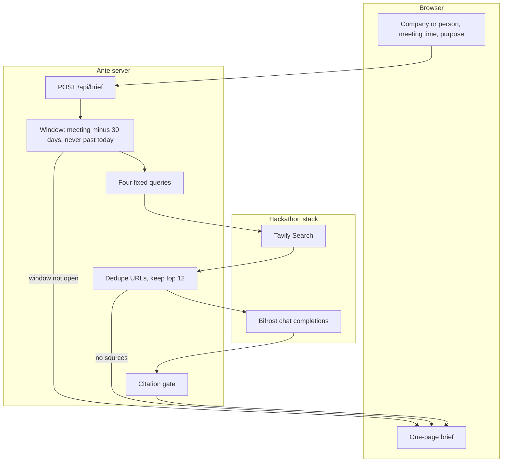
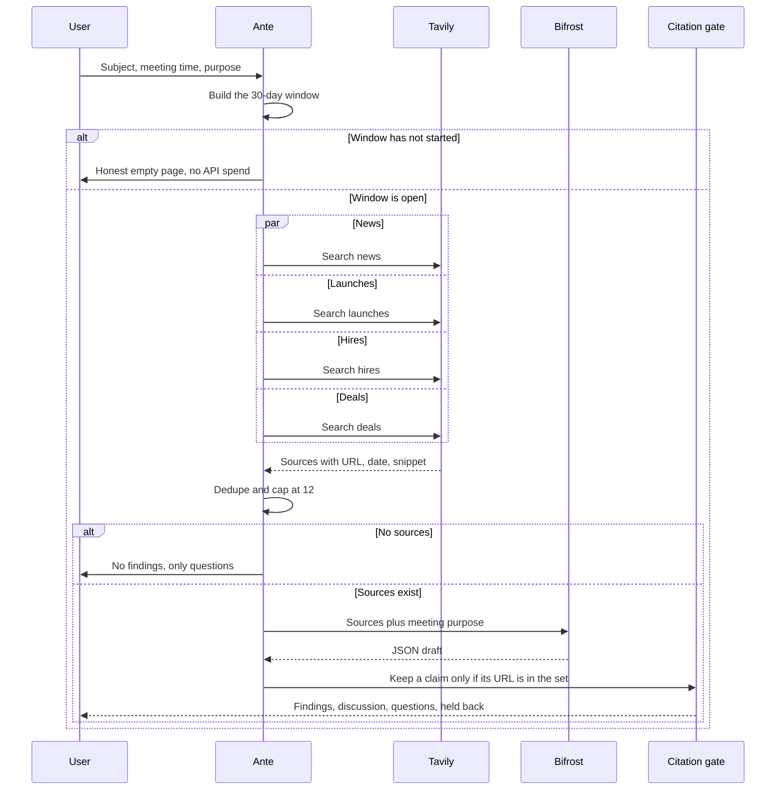

# Ante — Hackathon Plan

Problem 05, Tavily Research Agent. A pre-meeting briefing agent.

This document is for the team: what to show the judges, what the USP is, what to build before time runs out, and what to keep as the production roadmap in the pitch. The prototype deadline is **15 November 2026, 11:59 PM IST**. Confirm that time on the form before you submit.

---

## 1. The problem, in the judges' words

Before a meeting, news, launches, hires, and other updates about a company or a person are scattered across the web. Manual research takes time. A typical AI summary fails in two ways: it misses an important update, or it states something with no source as if it were a fact.

The ask is specific.

- Input: a company or a person, and the meeting time.
- Research: the 30 days before that meeting. News, launches, hires, and other meaningful updates.
- Output: a one-page brief.
- A source on every fact, so the user can check it.
- Discussion points and open questions.
- Separate what is confirmed from what is uncertain. Do not invent anything the sources do not support.
- Stack: Tavily for search, Bifrost for the model.

Optional directions: sales calls, partnerships, investor meetings, business development.

## 2. USP

**Ante prints a finding only when it can point at a Tavily link. Every other claim goes to Held back. It does not become a fact.**

One line, for the submission form and the first slide:

> Ante researches only the 30 days before the meeting, and prints a finding only when Tavily returned the source.

This USP matches the real pain in the problem statement: unsupported information presented as fact. Most teams will ship another summary app. We are shipping the gate that keeps an unsupported claim off the page.

Three differences from a generic agent.

| Point | Generic summary | Ante |
| --- | --- | --- |
| Date | "Latest news", which often includes old articles | The window is the 30 days before the meeting, and it never runs past today |
| Facts | Whatever the model writes lands on the page | A claim drops if its URL is not in the research set |
| Uncertainty | Everything sounds equally sure | Verified and Partial are separate. No date means it cannot rise above Partial |

Tavily's own meeting-prep sample is built around calendar and MCP. Do not copy it. Judges will recognize it. Our corner is different: a meeting-anchored window, a citation gate, and a one-page brief written through Bifrost.

## 3. What the code does now

`ante/` is a Node server. There is no package install.

1. The user enters a company or a person, a meeting time, a purpose (sales, partnership, investor, business development, or general), and an optional goal.
2. The server builds a window from 30 days before the meeting. If the meeting is in the future, the end is today. If that window has not started, there is no search, and the page says there is nothing to brief yet.
3. Four Tavily news searches run in parallel. For a company: news, launches, hires, deals. For a person: news, role, remarks, ventures.
4. Results are deduped by URL. The model sees at most 12 sources.
5. Bifrost writes a JSON brief. The system prompt says there is no fact outside the sources.
6. The citation gate is code, not a prompt. An unknown URL drops. A date outside the window drops. A source with no date stays Partial. A repeated claim is removed. At most 6 findings.
7. Discussion points and open questions sit in their own sections, captioned so they are not extra facts.
8. The footer shows Tavily, the Bifrost host, the model, and the estimated credit cost.

Credits: `basic` is 4 searches, about 4 credits. `advanced` is 8. The model call is a separate Bifrost request. An empty window or zero sources never calls the model.

## 4. Ideas — what to build, what to leave

The deadline is close. Put every idea in one of three buckets.

### Build tonight. Judges will see these.

All four are cheap. They need almost no new API. They come from source text we already have.

1. **Evidence line.** Under each finding, show the sentence from the Tavily snippet. The user can see where the claim came from without opening the link. This is the strongest shot in the demo.
2. **Coverage bar.** Show which of the four searches returned sources: News 3, Launches 1, Hires 0, Deals 2. The problem says summaries miss updates. An empty category is honest, and it shows the judges that we looked.
3. **Two sources, two stories.** If one source says "launched" and another says "still in beta", mark both Disputed. Do not pick a side and call it a fact.
4. **Demo cache.** Save the last successful brief to disk, with a button to show it. If the live call fails, the demo still stands. Fill the cache from a real run, never from invented text.

### If time remains, these change the pitch

5. **A second pass that only checks.** Send Bifrost the finding and the snippet. The answer is pass or fail. A fail goes to the gate. It is one extra small call. Add it only if the first demo feels loose.
6. **Name clarity.** Stripe is a company. Ada Lovelace is a person. The user already picks the type. That is enough. Do not add auto-detect today. A wrong type will sink the demo.
7. **One sentence from our side.** The "what you want from this meeting" field already exists. Tighten it in the prompt so the discussion questions sit on that deal, not on generic prompts.
8. **The printed page.** Print CSS is already there. Open print preview once in the demo. The one-page promise has to be visible. Do not let more than six findings through.

### Say it in the pitch. Do not build it today.

These are production ideas. Building them today would weaken the core.

- Google Calendar or Gmail. Tavily's official sample already does this. OAuth will eat the night, and the problem never asked for a calendar.
- A multi-agent swarm, voice, a Slack bot, a CRM. It looks large and checks out empty.
- Tavily Extract on every URL. Credits go up, the page gets long, and the one-page promise breaks. Use Extract only when the top snippet is too short to support a claim.
- Auto-detecting the meeting type. A dropdown keeps the model from wandering.

## 5. Architecture

Two layers. No framework in the middle, so a judge can read the flow.

**Page.** The form and the one-page sheet live in `public/`. State stays in the browser. Keys never reach the browser.

**Server.** `server.mjs` exposes two routes: `GET /api/health` (whether each key is set, never the value) and `POST /api/brief` (an NDJSON stream: status, each search, then the brief or an error).

**Pipeline, in order.**

| Step | File | Job | External call |
| --- | --- | --- | --- |
| 1 | `src/window.mjs` | Meeting minus 30 days, end = min(meeting, today) | None |
| 2 | `src/queries.mjs` | Four fixed queries, by company or person | None |
| 3 | `src/tavily.mjs` | `topic=news`, `start_date`, `end_date` | Tavily Search |
| 4 | `src/sources.mjs` | Normalize URLs, dedupe, keep top 12 | None |
| 5 | `src/model.mjs` | JSON brief | Bifrost `/chat/completions` |
| 6 | `src/gate.mjs` | URL, date, duplicates, cap at 6 | None |

Keys stay in `.env`. The Bifrost base URL includes `/openai/v1`. The virtual key goes out as `Authorization: Bearer`. The model name must be one the gateway already serves.

Keeping the gate outside the model is the architecture decision. A prompt can say "do not invent." The gate enforces it. That is the line to say to the judges.

### Architecture diagram

An empty window and a zero-source result never reach the model. That saves credits and stops an invented brief.

### Workflow

Keep the user's path short. Typing in the demo should take under 20 seconds.

1. Choose Company or Person.
2. Enter the name. Stripe is a good example.
3. Set the meeting time. The default is tomorrow at 3:00 PM.
4. Choose a purpose. A sales call is the cleanest demo.
5. Add one line about what you want from the meeting. Empty is fine.
6. Prepare the page.
7. The four searches show their status, then the sheet fills in.
8. Open a source on a finding. Read Held back. Print or copy.

The agent's internal path:

Confidence labels.

- **Verified.** The source text states the claim directly, and the publish date is inside the window.
- **Partial.** A source matched, but it has no date, or the wording does not state the claim outright.
- **Held back.** The model offered it and the gate refused it. Unknown URL, date outside the window, or a duplicate.
- **Discussion and open questions.** For the conversation. They do not get a fact stamp.

## 6. Optimization

Three things have to be tight at once: credits, time, and correctness. Correctness comes first. In this hackathon a wrong fact costs more than a slow app.

**Credits.**

- The query plan is fixed. We do not call a model to plan it. That saves a Bifrost round trip, and the plan cannot wander.
- Four searches run in parallel. Wall clock is about one search.
- Test on `basic`. Run `advanced` once before the demo, because the snippets are better and the evidence line gets stronger.
- `max_results` is 5. The model sees 12 sources, about 700 characters each.
- If there are no sources, Bifrost stays quiet.
- If the JSON is bad, we ask once more. There is no retry loop.

**Quality.**

- `temperature` is 0.1.
- The gate measures the date from Tavily's `published_date`, not from a date the model wrote.
- The title comes from the source, not from the model's title.
- The one-page limit is in code: 6 findings, 4 discussion points, 4 questions.
- Person queries and company queries are different, so an "appointed" search does not crowd out a product launch.

**Demo speed.**

- The stream exists so 10–20 seconds of waiting is not a blank screen. Judges should see the searches happen.
- A missing key returns a clear error. Never show a fake brief.
- Run one warm example ahead of time (Stripe, or a company the judges know). If the live call is slow, open that cached brief.

On 8,000 Tavily credits, `basic` is about 2,000 briefs. Running out of credits is not the risk. Burning `advanced` and Extract for no reason is the risk.

## 7. What we do at production level

In the pitch, this section is the product after the hackathon. Today's build is the sketch, not the factory.

**Trust.**

- The citation gate stays outside the prompt, in production too.
- Every claim stores the snippet span, not only the URL.
- Conflicting sources become Disputed on their own.
- Eval set: 15 names (companies and people), fixed windows. Four scores: groundedness, 30-day coverage, usefulness in the meeting, and invented facts at zero. Run this set before every release.
- Gate unit tests in CI. `node scripts/check.mjs` is the seed.

**Bifrost.**

- Each environment has its own virtual key, with a budget and a rate limit on that key.
- If the primary model fails, the gateway picks the fallback. The app does not hold a second provider key.
- Logs store the prompt shape, latency, search count, and how many claims were dropped. The private meeting note is not stored in full.
- After a model swap, run the eval set again. A cheaper model stays only if groundedness holds.

**Tavily.**

- Cache key: subject + window + kind. TTL of 6 hours. Reopening the same meeting does not spend credits again.
- Use `advanced` only on a category where `basic` came back empty.
- Extract only the top 3 URLs, and only when the snippet is under 200 characters.
- A domain blocklist for content farms and undated homepages, if the eval set shows that noise.

**Product.**

- Team accounts, a link to the brief, PDF export.
- Add a calendar only after the gate is stable. The event fills in the name and the time. The research rule stays the same.
- User correction: "this claim is wrong" is saved against that source and becomes a negative example in a later prompt.

**Limits to say out loud.**

- Public web only. Private deals, inboxes, and CRMs are out of scope.
- Tavily filters on publish date, not on "last updated." A live page with an old publish date can be missed.
- A meeting far in the future leaves the window empty. That is the rule, not a bug.
- Partial means "a source matched, and the confidence is incomplete." Do not read it as Verified.

## 8. The four-minute demo

1. **0:00–0:30.** The problem in one sentence. A summary either misses the update or invents one. Ante stops both.
2. **0:30–1:30.** Stripe, tomorrow at 3:00 PM, sales call. Show the searches running. Read the window dates.
3. **1:30–2:30.** Open the link on a Verified finding. Show a Partial. Read Held back: "The model offered this. The gate removed it."
4. **2:30–3:15.** Move the meeting six months out. The page should refuse. No invented news.
5. **3:15–4:00.** Footer: Tavily, Bifrost host, credits. Say that a model swap happens on Bifrost, not in the app. In production: the eval set and a virtual-key budget.

If the live call stalls, open the cached brief and say it is the last real search. Do not start talking over an empty page.

## 9. If the judges ask

**Can the model still lie?** Yes. That is why the gate exists. A claim whose URL is outside the set never becomes a fact on the page. A claim inside the set, with no date, never becomes Verified. Matching the snippet span is the next tightening screw.

**How are the 30 days actually enforced?** Tavily receives `start_date` and `end_date`. The gate cuts the date again. For a future meeting the end is today, because tomorrow's news does not exist yet.

**Why Bifrost, instead of calling a model directly?** It is the hackathon gateway. Keys, budgets, fallbacks, and logs sit in one place. The app makes an OpenAI-compatible chat call and does not hold a provider key.

**What about Tavily's own agent?** That one connects a calendar. This problem asks for a sourced 30-day window and a split between certain and uncertain. That is what we built.

**What is production latency?** Four parallel searches, one model call, a local gate. A cached meeting opens almost immediately. Extract does not run on every link.

**What if the credits run out?** An unopened window or zero sources never calls the model. The demo cache is separate. `basic` is the default.

## 10. Tonight's order

1. Put the Tavily key, Bifrost URL, virtual key, and model name in `.env`.
2. Run one real brief. Take screenshots: the full page, one source opened, Held back, and the empty window.
3. If time remains, add only two things: the evidence line, and the coverage bar. A third, if it still fits: the demo cache.
4. Public GitHub repo. Keep the README. Link this plan from it.
5. Six slides: problem, USP, architecture diagram, one real page, a gate example, production roadmap.
6. On the form: name Ante, track Problem 05, and the one-line from the README.

Do not fill the slides with a feature list. One sentence, one diagram, one real page.
