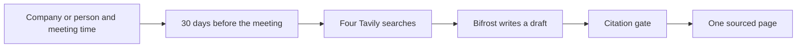

# Ante

A pre-meeting briefing agent for the Global AI Hackathon, Problem 05.

> Ante researches only the 30 days before the meeting, and prints a finding only when Tavily returned the source.

This is the document to give the judges. It says what we are building, why it answers the problem, and how the system does it. The build steps are in `docs/build-plan.md`.

---

## The problem

Someone has a meeting with a company or a person. The useful context from the last month is scattered: a launch, a hire, a round, a public remark, a deal. Collecting it by hand takes longer than the meeting is worth.

Asking a model to summarize "the latest" creates a second problem. The summary misses the update that matters, or it writes a confident sentence that no article supports. The reader cannot tell which lines to trust, so they either walk in under-prepared or they repeat something that is not true.

The brief has to be short enough to read once before the meeting, sourced enough to check, and honest enough to show what is still unknown.

## What we are building

Ante is that page.

The user gives three things: who the meeting is with, when it is, and what kind of conversation it is. A sales call, a partnership, an investor meeting, a business-development conversation, or a general one. They can add one line about what they want from the meeting.

Ante returns a single page:

- **Findings** from the 30 days before the meeting. News, launches, hires, and other material updates. At most six.
- **A source link on every finding**, plus the snippet sentence the claim came from.
- **A confidence label.** Verified means the source states it and the date is inside the window. Partial means a source matched but the date is missing or the wording is softer. Disputed means two sources in that window do not agree, and we show both.
- **Held back.** Claims the model offered that did not survive the citation check. They are visible, and they are not facts.
- **Discussion points and open questions** for the conversation. They are labeled as prompts, not as extra news.
- **Coverage.** How many sources came back for news, launches, hires, and deals. A zero stays on the page, so a missed category is visible.

If the meeting is so far away that those 30 days have not started, Ante says so and does not write a fake brief.

## Why this is the answer

The problem statement asks for recent research, a one-page brief, source attribution, discussion points, open questions, and a clear split between verified and uncertain information. It also says the agent should not invent unsupported details.

A chat summary can sound like it did all of that. Ante makes the split mechanical.

The meeting time sets the window. Tavily searches that window. Bifrost may only write from the sources that came back. A separate citation gate, written in code, drops any claim whose URL was not in those results, drops dates outside the window, and refuses to mark an undated source as Verified. Discussion points never receive a fact label.

The user can check a line in one click, see what was refused, and see which search came back empty.

## How we do it

1. **Set the window.** Start is 30 days before the meeting. End is the meeting day, or today if the meeting is still ahead. A window that has not started stops the pipeline. No search, no model call.

2. **Search four ways, in parallel.** Tavily's news search, with `start_date` and `end_date`. For a company the four queries are news, launches, hires, and deals. For a person they are news, role changes, public remarks, and ventures. Fixed queries keep the search on the categories the problem names, and they keep the credit cost predictable: four searches, four or eight Tavily credits depending on depth.

3. **Keep the best sources.** Results are deduped by URL. The model sees at most twelve, with a short snippet and a publish date when Tavily has one.

4. **Write through Bifrost.** One chat completion on the hackathon gateway. The model returns JSON: a one-line read of the window, findings with a source URL copied from the list, discussion points, and open questions. Temperature stays low. The prompt forbids facts that are not in the sources. The gateway holds the model key, the budget, and any fallback model. The app does not call a provider directly.

5. **Run the citation gate.** This step is code. A finding stays only if its URL is one Tavily returned. The date on the page is Tavily's publish date. Outside the window, the claim is held back. No date, and the label cannot be Verified. Duplicate claims are removed. The page caps at six findings so it stays one page. An evidence line is taken from that source's snippet, not written by the model. If two kept sources contradict, both are marked Disputed.

6. **Show the page.** Findings, coverage, discussion, open questions, and held-back claims. The footer names Tavily, the Bifrost host, the model, and the credit cost of that run.

An empty window or a search with no sources never reaches Bifrost. There is nothing to summarize, so the page says that, and the only lines left are questions worth asking in the room.

## What the judges will see

A four-minute demo, on a real company.

- A sales-call brief for a meeting tomorrow. The window dates are on the page.
- The four searches finishing in the open, including a category with zero sources.
- One Verified finding. Open its source. The evidence line is in the article snippet.
- One Partial or Disputed line, so uncertainty is visible.
- Held back: a sentence the model tried to add, and the reason the gate removed it.
- The same subject with a meeting six months away. The page stays empty. No invented news.
- The footer: Tavily for search, Bifrost for the writing.

If the live network stalls, we open the last real brief saved from a previous run and say so. We do not substitute a handwritten sample.

## What we are explicit about

Ante reads the public web. It does not see a private inbox, a CRM, or a closed deal. Tavily filters on publish date, so a page that stays "live" under an old date can be missed. Partial is incomplete confidence, not a softer kind of Verified. A meeting far in the future has no 30-day record yet, and the product will say that rather than fill the page.

Those limits are the same rules that make the brief trustworthy.

## After the hackathon

The gate stays outside the prompt. Each claim keeps its snippet span. Briefs for the same subject and window are cached so a second open does not spend credits again. Bifrost virtual keys carry the budget, the rate limit, and the fallback model. An evaluation set of companies and people, on fixed windows, scores groundedness, 30-day coverage, usefulness in the meeting, and invented facts. A calendar can fill in the name and the time later. It does not get to change the research rule.

## The line to leave them with

Most meeting prep tells you a story. Ante shows you the 30 days before you walk in, and it will not print a line it cannot point at.
